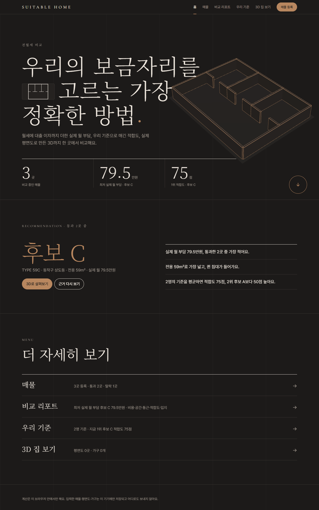
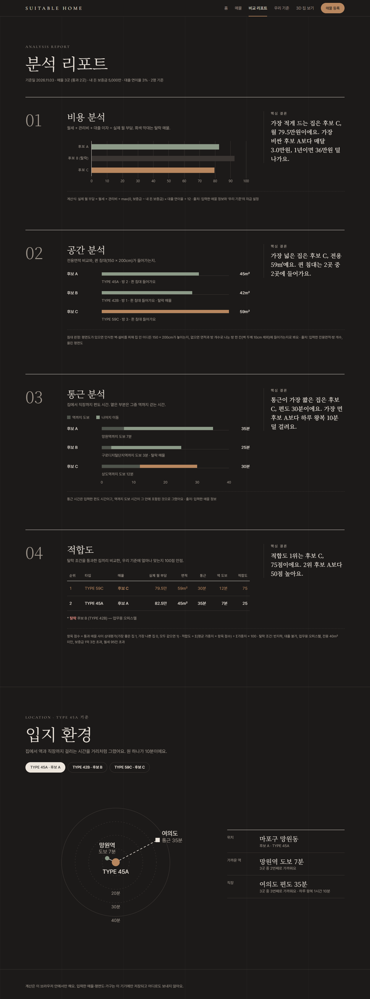
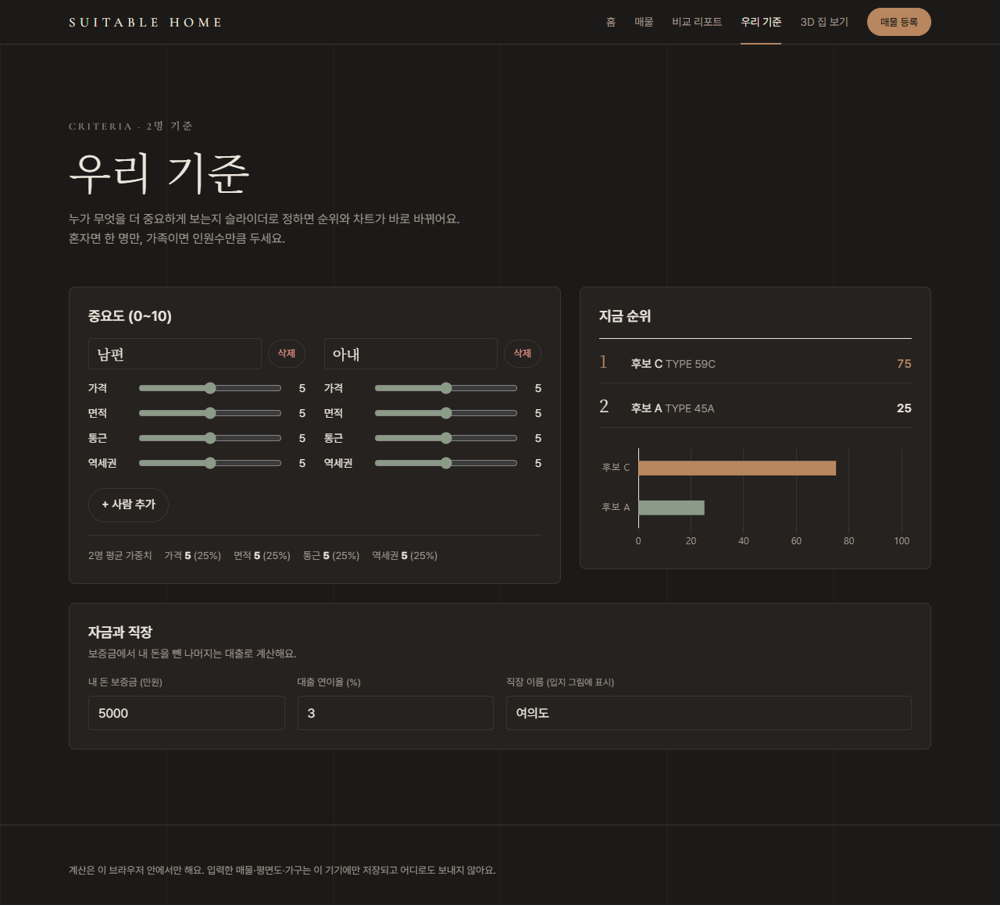
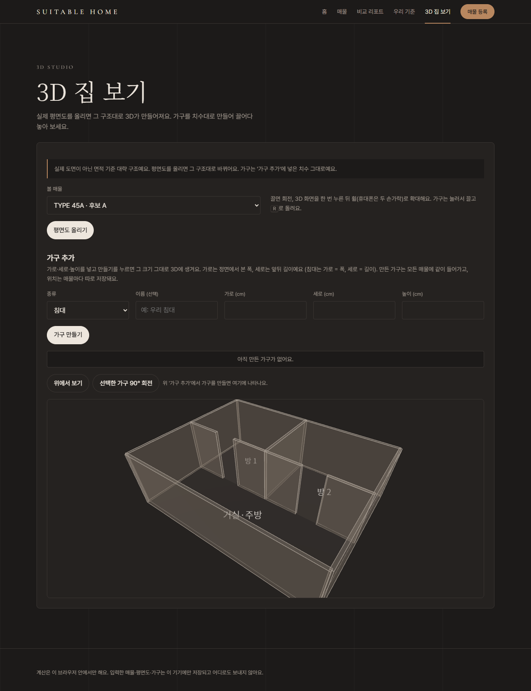

# SUITABLE HOME — 전월세 비교

**우리의 보금자리를 고르는 가장 정확한 방법.**
방 매물이 우리에게 얼마나 맞는지(적합도) 따져 보는 전월세 비교 웹앱입니다. HTML 파일 하나로 동작하고, 설치나 서버가 필요 없습니다.

▶ 사이트: https://dionelee.github.io/suitable-home/

## 기능

- **실제 월 부담**: 월세 + 관리비 + (보증금 − 내 돈) × 대출 이율 ÷ 12
- **자동 탈락**: 반지하, 대출 불가, 업무용 오피스텔, 전용 40㎡ 미만, 보증금 1억 3천 초과, 월세 95만 초과 — 사유와 함께 표시
- **적합도**: 가격·면적·통근·역세권 중요도를 사람마다 슬라이더로 정하고(인원 추가·삭제 가능) 평균으로 100점 만점 순위
- **비교 리포트**: 01 비용 · 02 공간(퀸 침대가 들어가는지) · 03 통근 · 04 적합도 + 입지. 장마다 핵심 결론과 계산식
- **평면도 → 3D**: 네이버 부동산 평면도 이미지를 올리면 벽·주방 카운터·변기·세면대·욕조를 자동 인식해 Three.js 3D로 세움
- **가구 배치**: 가로·세로·높이(cm)를 넣으면 그 크기 그대로 3D 가구가 생기고, 벽·설비·다른 가구에 부딪히지 않게 끌어서 배치
- 데이터는 브라우저(localStorage)에만 저장되고 어디로도 보내지 않습니다.

## 기술

HTML · CSS · JavaScript (빌드 없음), [Chart.js](https://www.chartjs.org/) 4.4.1, [Three.js](https://threejs.org/) 0.160.0, 브라우저 이미지 처리(Otsu 임계값, 모폴로지 연산, 정규화 상관 템플릿 매칭).

## 화면

| 비교 리포트 | 우리 기준 | 3D 집 보기 |
|---|---|---|
|  |  |  |

디자인 변천: `screenshots/before_*`(처음) → `after_*`(한 페이지 리디자인) → `after2_*`(메뉴 분리) → `after3_*`(지금).

## 문서

- `docs/design/` — 기능별 흐름도(mermaid): 평면도 3D, 가구·설비, 인원별 가중치, 리디자인
- `design-guidelines.md` — 디자인 토큰(색·글꼴·간격·모션)
- `scripts/verify/screenshot.py` — 데스크톱 1280·모바일 390 전체 페이지 스크린샷
