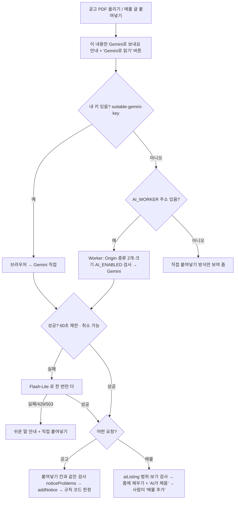

# AI 읽기 (Gemini) — 공고 PDF · 매물 글

AI는 **읽기만** 한다. 공고 자격 판정은 기존 규칙 코드(`elig`)가, 매물 저장은 사람이 '매물 추가'로 한다.
보내는 것: 공고 PDF 또는 붙여넣은 매물 글 + 앱 지시문뿐 (소득·자산·지금 집·직장·가족 정보는 보내지 않음).

| 항목 | 값 |
|---|---|
| 모델 | `gemini-3.6-flash` → 실패 시 `gemini-3.5-flash-lite` 한 번 (2026-11-05 공식 문서, 둘 다 무료 등급·무료 등급 데이터는 제품 개선에 쓰임) |
| 응답 형식 | `responseMimeType: application/json` + `responseSchema` (NOTICE_SCHEMA / LISTING_SCHEMA) |
| 크기 | PDF 5MB (브라우저·Worker 둘 다 검사, Worker 는 PDF 를 해석하지 않고 inline_data 로 넘김), 글 5,000자 |
| 시간 | 60초 지나면 끊음 (화면 '읽는 중… 취소', Worker `AbortSignal.timeout`) |
| 지시문 | index.html AI_SPEC 블록 하나 → `python scripts/sync_ai_spec.py` 로 `worker/src/spec.js` 복사 (`--check` 로 같은지 검사) |
| 내 키 | localStorage `suitable-gemini-key` (저장 데이터 `newlywed-home-v1`·내보내기와 따로) |
| Worker | `worker/` · Origin 허용 목록 · `/notice` `/listing` 두 가지만 · 로그 없음 · `AI_ENABLED=false` 면 503 · 배포 `https://suitable-home-ai.demolee.workers.dev` |
| 지역 | Gemini 는 홍콩 요청을 막음 → Gemini 호출은 미국 서부(wnam) Durable Object 에서 |
| 실측 (2026-11-05) | 가상 매물 글 3개 틀림 0·지어냄 0 (8~16초) · 예시 공고 PDF 22초, 자격·소득표·주택형·가격·일정 날짜 정답과 같음 (일정 이름 표기만 다름) |

검사: `node scripts/verify/worker_check.mjs` (14) · `python scripts/verify/ai_check.py` (32, 가짜 Gemini 응답)

## v25 화면 (2026-11-05)
- 매물 글: 보내기 안내("이 내용만 Gemini로 보내요")가 처음부터 버튼 위에 있고, 버튼은 "AI로 읽기" 하나. 누르면 바로 보낸다(보내는 내용은 그대로 글만).
- 공고 PDF: 파일을 고르면 안내 → "AI로 읽기".
- 끝나면(성공·실패·취소) "읽는 중" 문구를 지우거나 실패 문구로 바꾼다.
- 채운 칸은 테두리 색(`.ai-filled`)으로만, 위에 "AI가 N칸을 채웠어요" 한 줄. 사람이 고치면 그 칸 색 해제.
