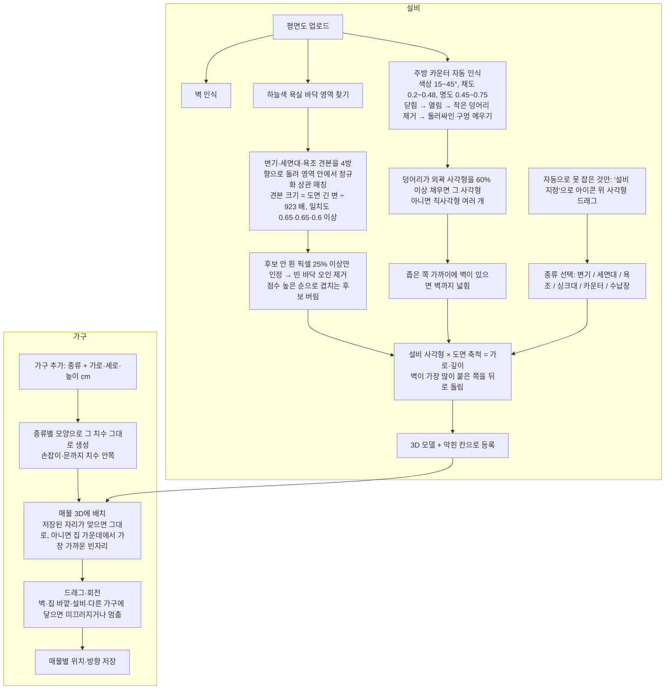

# 우리 가구 · 설비 3D

- 가구: 하나의 공통 목록(`state.furniture`, 치수 cm). 매물마다 위치·방향만 `listing.layout[가구id]`에 저장.
- 설비: 평면도마다 `plan.fixtures`(격자 칸 좌표). 업로드할 때 도면 위치 그대로 자동 인식한다. 주방 카운터는 색으로, 변기·세면대·욕조는 네이버 부동산 도면 아이콘 견본 매칭으로 찾는다. 자동으로 못 잡은 것만 도면에서 사각형을 드래그해 추가한다.
- 가구 추가 칸은 3D 화면 바로 위에 있다(가로·세로·높이 cm).
- 도면에는 높이가 없어서 설비 높이는 표준값을 쓴다: 변기 0.75, 세면대 0.85, 욕조 0.55, 싱크대·카운터 0.85, 수납장 2.0m.

