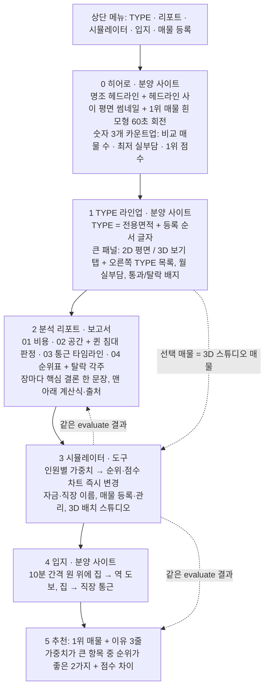
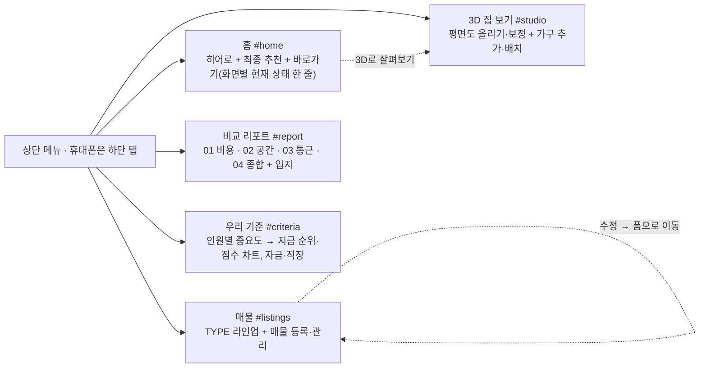

# 리디자인 — 섹션 흐름

토큰과 규칙은 `design-guidelines.md`. 원본은 `index_v1_backup.html`.
계산·평면도 인식·가구·저장 로직은 바꾸지 않았고, 화면 구성과 새 섹션을 그리는 함수(`renderHero`, `renderTypes`,
`renderReport`, `renderSim`, `renderLocation`, `renderFinal`)와 전시용 3D 모형(`maquette`, `showcase`)을 추가했다.

## 퀸 침대 판정 (02 공간)

- 평면도 없음: 면적·방 개수로 나눈 대략 구조의 방 한 칸(벽 10cm 제외)에 150×200cm가 들어가는가 (`bedFitsBox`).
- 평면도 있음: 인식한 벽·설비·집 바깥을 피해 집 안 어디든 150×200cm가 놓이는가 (`bedFitsPlan`, 평면도 버전별 캐시).

## 스크린샷

`python scripts/verify/screenshot.py <접두어> [html]` — 데스크톱 1280, 모바일 390(헤드리스 Chrome 최소 창 폭 500 때문에 iframe 으로 찍음).

## 2차: 메뉴별 화면 분리 (2026-11-03)

한 페이지(데스크톱 8,500px)를 메뉴 5개로 나눴다. 주소 끝 `#이름`으로 화면을 고르고 뒤로 가기·링크 공유가 된다.
예전 한 페이지 주소(`#type`, `#sim`, `#location`, `#manage`)는 새 화면으로 연결한다. 휴대폰은 하단 탭.

## 점검 반영 (break-ui · mobile-native · review-animations · animation-performance)

- 극단 데이터: 긴 이름은 자르고 전체는 `title`로, 매물 0개·전부 탈락 빈 상태, 동점 순위(`rankOf` = 1 + 엄격히 나은 수),
  60분 이상은 `fmtMin`으로 '1시간 30분', 입지·통근 눈금 간격 10/30/60분 자동, TYPE 글자는 매물마다 저장(`tl`, I·O 제외).
- 휴대폰: hover 는 `@media (hover: hover)` 안에만, 탭 하이라이트 제거, `:active` 눌림, 숫자 키패드(`inputmode`),
  3D·평면도 캔버스 높이 제한(스크롤 갇힘 완화), 두 번째 손가락 무시(pointerId).
- 모션: 3D 스튜디오는 화면에 보일 때만 그림, 차트는 입력 중 즉시 갱신(`update('none')`),
  전시 모형은 시간 기준 회전(주사율과 무관하게 60초/바퀴) + 30fps + 해상도 1.5배 상한, 움직임 줄이기는 움직임만 끈다.

## 3차: SUITABLE HOME · 밤의 모델하우스 (2026-11-03)

레퍼런스: theclav60.com(밤 톤, 카라멜 브론즈, 자간 넓은 세리프 대문자, 입장 연출), brand.hldni.com(EFETE: 숯색 바탕, 옅은 세로 격자선, 둥근 스크롤 버튼).

- 이름 `SUITABLE HOME` — 방 매물이 우리에게 얼마나 맞는지(적합도) 찾는 서비스. '종합 점수'는 화면 전체에서 '적합도'로.
- 홈: 라벨 '전월세 비교', 헤드라인 '우리의 보금자리를 고르는 가장 정확한 방법.'(마침표만 브론즈).
- 색 토큰은 `design-guidelines.md` 2차. 전시 모형은 어두운 벽 + 브론즈 선, 편집 3D 장면도 어두운 바탕.
- 입장 연출: 첫 방문 때만(localStorage `suitable-intro`), 브론즈 화면 → 창문 격자 40칸 → 로고, 1.6초, 누르거나 키 입력 시 건너뜀,
  스크린샷(#shot)·움직임 줄이기면 생략.
