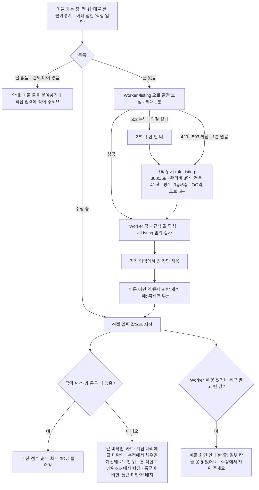

# v30 새 주소 정리 · 매물 등록 한 번에 (2026-11-12)

새 주소 https://suitable-home.pages.dev (상수 `NEW_SITE` 한 곳). 예전 주소(dionelee.github.io)에는 '주소가 바뀌었어요' 띠 + '내 데이터 옮기기'(바로 내보내기).

## 등록 흐름

- 화면에서 뺀 것: AI 문구(AI로 읽기 · AI가 채움 · Gemini로 보내요 · 직접 붙여넣기), '데이터와 AI 설정' 칸, 내 키 입력과 키로 Gemini 직접 부르던 코드. 기기에 남은 예전 키 값(`suitable-gemini-key`)은 지우지도 쓰지도 않는다.
- `AI_SPEC` 블록(worker/src/spec.js 와 같은 지시문)은 그대로 둔다 (`scripts/sync_ai_spec.py --check`).

## 백업 (#backup)

- 메뉴에는 없고 맨 아래 '백업' 링크로만. 내보내기 · 불러오기 · 예시 데이터로 초기화.
- 불러오기는 전체 덮어쓰기라 "불러오면 지금 이 기기의 매물·평면도가 파일 내용으로 바뀌어요" 안내 + 파일을 고른 뒤 화면 안에서 '바꾸기 / 취소' (confirm() 안 씀).
- 평면도는 사진·인식 칸(mask·gw·gh)·축척(scaleM)·창 쪽·고정물·방향(facing)까지 state 그대로 내보낸다. **사진은 줄이지 않는다** — 예전에는 40만 자 넘는 사진을 900px JPEG 로 줄였는데, 그러면 색으로 나눈 방·거실 구분이 달라졌다(v30_check 에서 확인). 치수(인식 칸·축척·면적)는 줄여도 같았다.

## 검사

`python scripts/verify/ai_check.py` (등록 흐름 25) · `v30_check.py` (값 미확인·백업·예전 주소 띠·평면도 치수 보존 20) · `v27_check.py` · `v8_check.py` · `v10_check.py` · `node scripts/verify/worker_check.mjs`
