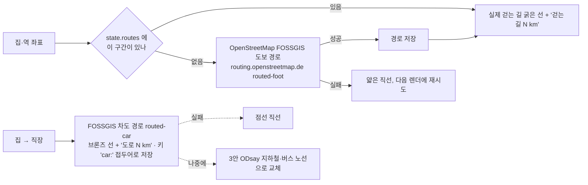
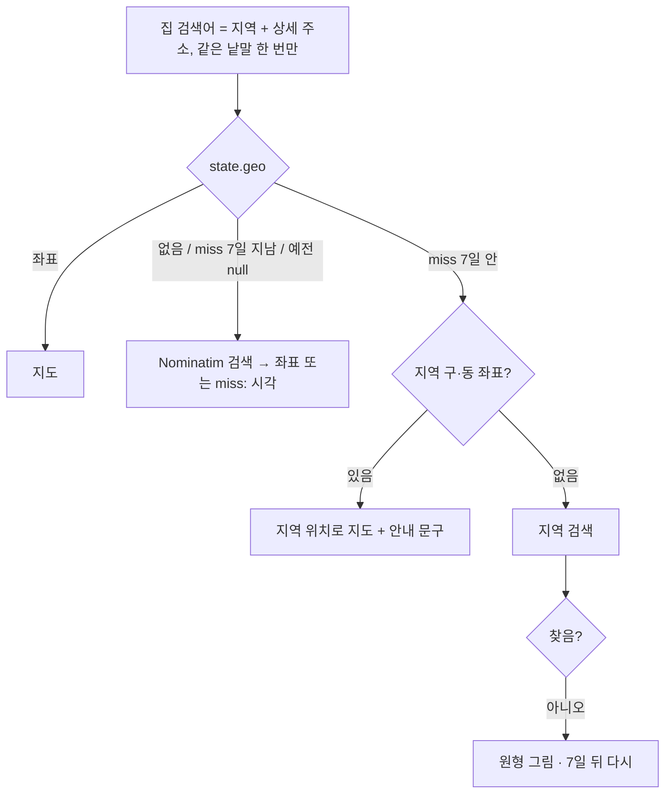

# 입지 지도 (A안: Leaflet + OSM 기본 지도(CSS 필터로 밤 톤) + OpenStreetMap 위치 검색)

카카오맵(무료 쿼터가 계정당 첫 앱 하나에 고정되는 조건)과 네이버 지도(대표 계정 무료 조건 + NCP 가입)를 검토한 뒤, 키가 필요 없는 오픈 지도로 정했다.

```mermaid
flowchart LR
    A[매물: 지역 + 상세 주소(선택) · 가까운 역<br/>설정: 직장 이름] --> B{저장된 좌표의 검색어가<br/>지금 검색어와 같은가}
    B -- 같음 --> C
    B -- 다름/없음 --> Q[OpenStreetMap Nominatim 위치 검색<br/>1초에 1건 줄 세워 요청 · 한국으로 한정]
    Q -- 찾음 --> S[좌표를 매물·설정에 저장] --> C
    Q -- 못 찾음 --> F[실패도 저장(같은 검색어 재요청 안 함)]
    C[OSM 지도 + 어두운 필터<br/>집 = 브론즈 점 · 역 = 세이지 점 + 실선 · 직장 = 점선<br/>직선거리 km + 입력한 도보·통근 분] 
    F --> G[지금의 시간 원 그림으로 대체<br/>'상세 주소를 적어 주세요' 안내]
    Q -. 지도 라이브러리·네트워크 실패 .-> G
```

- 페이지 스크롤을 빼앗지 않도록 휠 확대는 지도를 누른 뒤에만, 휴대폰은 한 손가락 끌기 대신 두 손가락 확대.
- 예시 매물 3곳과 '여의도'는 좌표를 미리 넣어 두어 처음 방문에 위치 검색 요청이 나가지 않는다.
- 지역·역·직장 이름은 위치 검색을 위해 OpenStreetMap 에 보내진다 — 화면 하단 안내 문구에 적는다.
- CARTO 어두운 지도는 키를 요구하게 바뀌어(타일에 API KEY REQUIRED) OSM 기본 타일에 CSS 필터를 씌웠다.

## 도보·도로 경로 (1안, 2026-11-03)



## v11 고침 (2026-11-04)



- 예전: '서초구 방배동 방배동 100-1'처럼 동 이름이 두 번 들어가 검색이 실패했고, 실패(null)를 영구히 저장했다.
- 입지 '○곳 중 ○번째로 가까워요'는 통과 매물끼리만 센다(지금 집·탈락 매물은 순위 없음).
