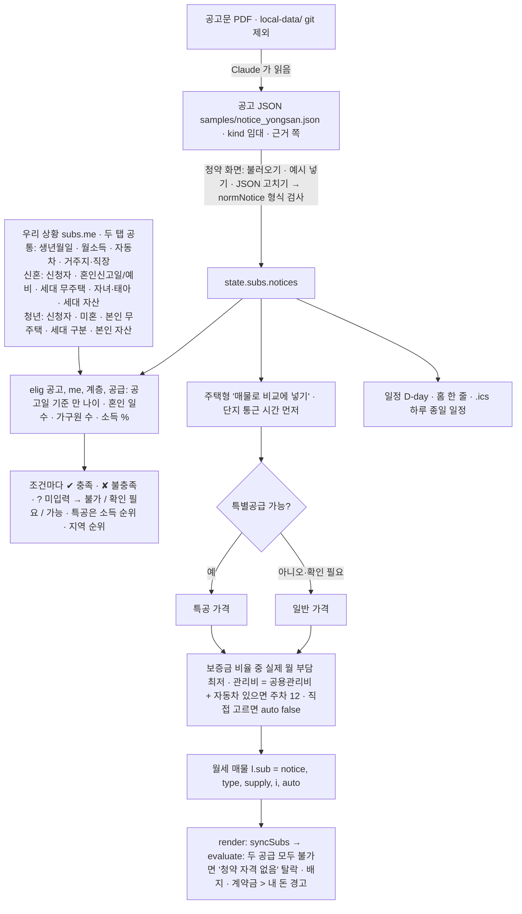

# 청약 — 임대 공고 예비 판정 (v10, 2026-11-04)

grill-me 로 정한 13가지(공고 단위 · Claude 가 공고 JSON 작성 · 기준값은 공고 JSON · 날짜 입력 · 주택형별 매물 · 일정 D-day·ics · 가능/불가/확인 필요 · 용산 공고 공개 예시 · 메뉴 '청약' · 임대부터 · 자동 조건 선택)와, 이후 결정(청년도 판정 · 신혼부부/청년 탭 · 청년형 40㎡ 미만 탈락 유지 · 자동차 있을 때만 주차 · 연소득 → 월 환산 칸). 백업: `index_v10_backup.html`.

- 판정은 **예비 판정**이다. 「주택공급에 관한 규칙」 제53조 무주택 예외, 자동차 지분·차종 예외, 부동산 세부 자산 기준은 판정하지 않는다(사용자가 고른 값만).
- 소득표는 공고에 "전년도"라고만 있어 통계 연도를 확인할 수 없다. 공고 값을 그대로 쓴다.
- 청년 특공의 소득 산정은 공고 문구가 겹쳐 애매하다 → 세대 구분(단독 / 세대원 있음 / 무소득 = 본인 + 부모 3인)을 사용자가 고른다.
- 방 개수(신혼 2 · 청년 1)는 공고에 없어 가정했다.
- 검사: `python scripts/verify/v10_check.py` (29항목), 스크린샷 `python scripts/verify/screenshot.py after_v10_ index.html subs,home --seed scripts/verify/seed_v10.json` (우리 상황은 가짜 값).
