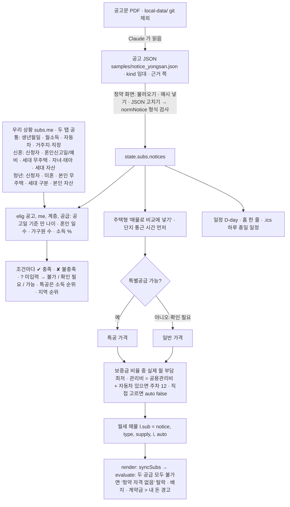
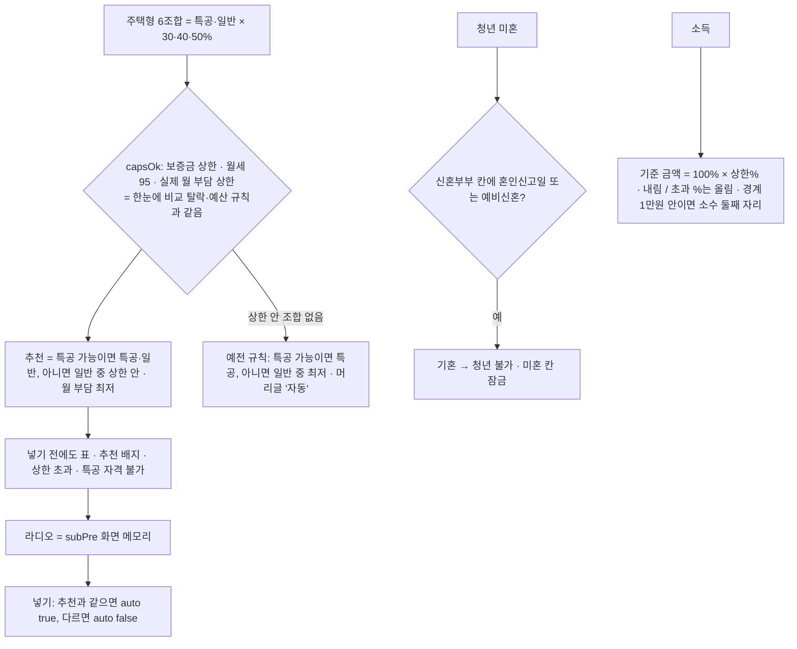
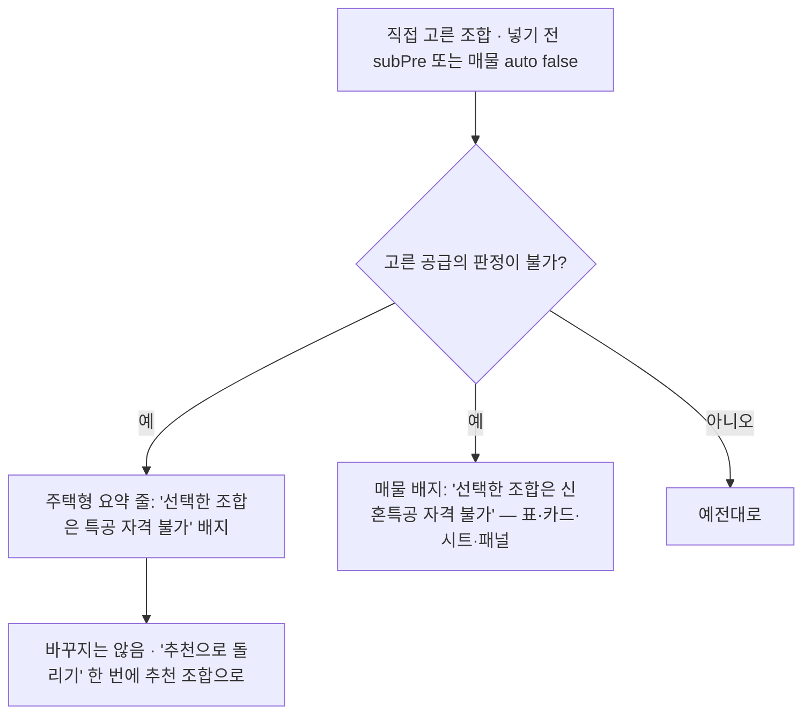
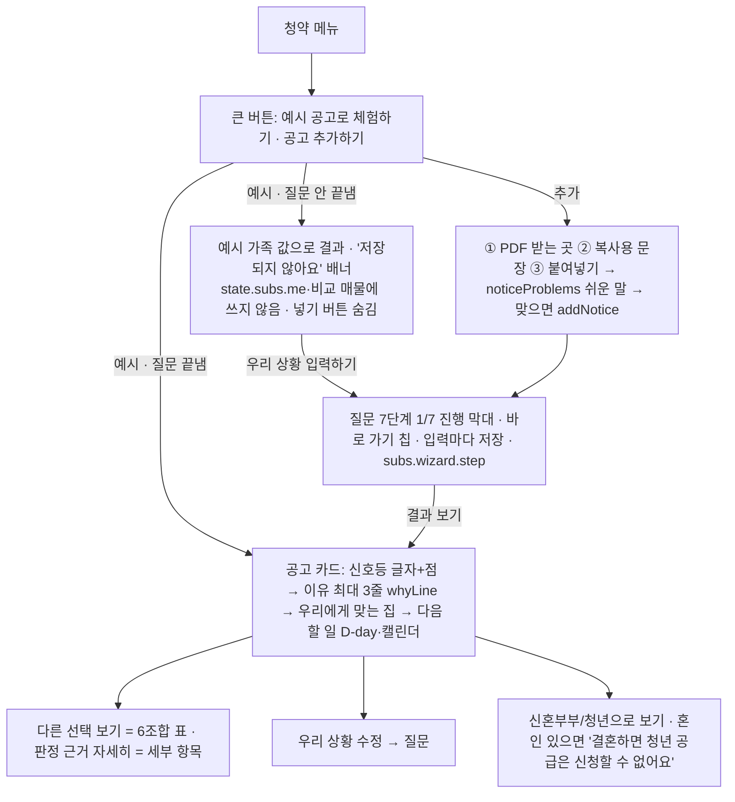
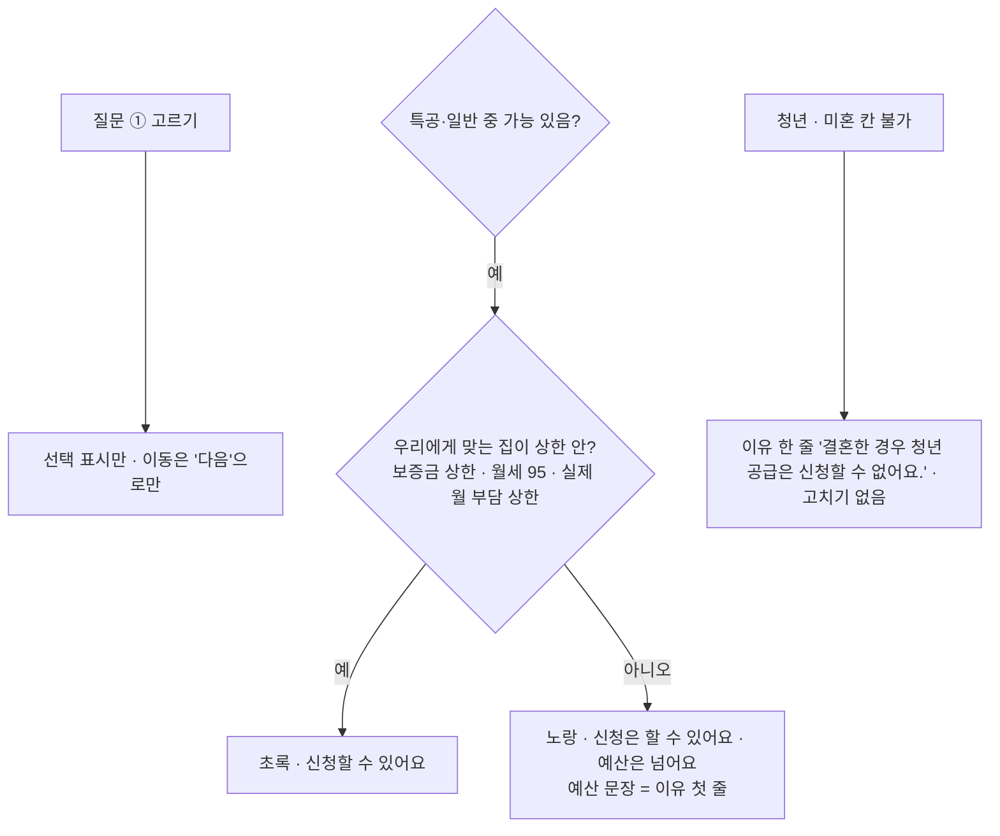

# 청약 — 임대 공고 예비 판정 (v10, 2026-11-04)

grill-me 로 정한 13가지(공고 단위 · Claude 가 공고 JSON 작성 · 기준값은 공고 JSON · 날짜 입력 · 주택형별 매물 · 일정 D-day·ics · 가능/불가/확인 필요 · 용산 공고 공개 예시 · 메뉴 '청약' · 임대부터 · 자동 조건 선택)와, 이후 결정(청년도 판정 · 신혼부부/청년 탭 · 청년형 40㎡ 미만 탈락 유지 · 자동차 있을 때만 주차 · 연소득 → 월 환산 칸). 백업: `index_v10_backup.html`.

- 판정은 **예비 판정**이다. 「주택공급에 관한 규칙」 제53조 무주택 예외, 자동차 지분·차종 예외, 부동산 세부 자산 기준은 판정하지 않는다(사용자가 고른 값만).
- 소득표는 공고에 "전년도"라고만 있어 통계 연도를 확인할 수 없다. 공고 값을 그대로 쓴다.
- 청년 특공의 소득 산정은 공고 문구가 겹쳐 애매하다 → 세대 구분(단독 / 세대원 있음 / 무소득 = 본인 + 부모 3인)을 사용자가 고른다.
- 방 개수(신혼 2 · 청년 1)는 공고에 없어 가정했다.
- 검사: `python scripts/verify/v10_check.py` (29항목), 스크린샷 `python scripts/verify/screenshot.py after_v10_ index.html subs,home --seed scripts/verify/seed_v10.json` (우리 상황은 가짜 값).

## v12 — 넣기 전에 조합 고르기 · 추천 · 소득 문구 · 청년 기혼 자동 (2026-11-04)

- 문구 예: 704만 → "120.01% (120% 초과 · 기준 703.95만)", 800만 → "136.4% (120% 초과 · 기준 703.9만)".
- 검사: `v10_check.py` 30항목 (혼인신고일 있으면 청년 미혼 칸 잠김·불가 추가), selfTest 에 문구·추천 검사.

## v13 — 직접 고른 조합이 자격 불가가 되면 경고 (2026-11-04)

- 두 공급 모두 불가면 예전대로 '청약 자격 없음' 탈락.

## v14 — 처음 쓰는 사람용 화면 (2026-11-04) · 판정 계산은 그대로

- 질문 ① 답이 `subs.tab` (탭은 없앰). 청년을 고르면 신청자 = 사람 1.
- elig 의 항목에 숫자(`k, v, lim, who`)만 덧붙여 쉬운 말을 만든다. 판정(✔·✘·?)·순위·조합 계산은 바꾸지 않음.
- 신호등: 특공·일반 중 하나라도 가능 = 신청할 수 있어요 · 가능 없고 미입력 있음 = 확인이 필요해요 · 둘 다 불가 = 이 공고는 어려워요.
- 사는 곳·직장: 시·도 17 + 서울이면 25개 구, 그 밖은 직접 입력(예: 경기 의왕시 저장). 지역 순위는 예전대로 서울/해당 구만 본다.
- 자산 '잘 모르겠어요' = 빈 값(확인 필요), `subs.wizard.unk.asset` 로 체크 표시만 기억.
- 검사: `v10_check.py` 42항목 (예전 데이터는 바로 결과 · 연봉 4100 반올림 · 예시 가족 비저장 · 750만 쉬운 이유 · 붙여넣기 검사 · 의왕시 · 처음 온 사람 클릭 2번 · 390 한 열).

## v15 — 쉬운 화면 사용성 수정 (2026-11-04)

- '으로/로'는 받침으로 고른다(ㄹ 받침·받침 없음 = 로): 신혼부부로 · 청년으로.
- 통근 칸: "이 단지에서 직장까지 편도 몇 분인가요?" · 예: 50 · 분.
- 검사 `v10_check.py` 47항목: 처음 사용자 흐름을 '다음'으로 한 칸씩 클릭(1/7이 두 번 = 고르기만으로 안 넘어감) → 650만 특공 가능·3순위.
