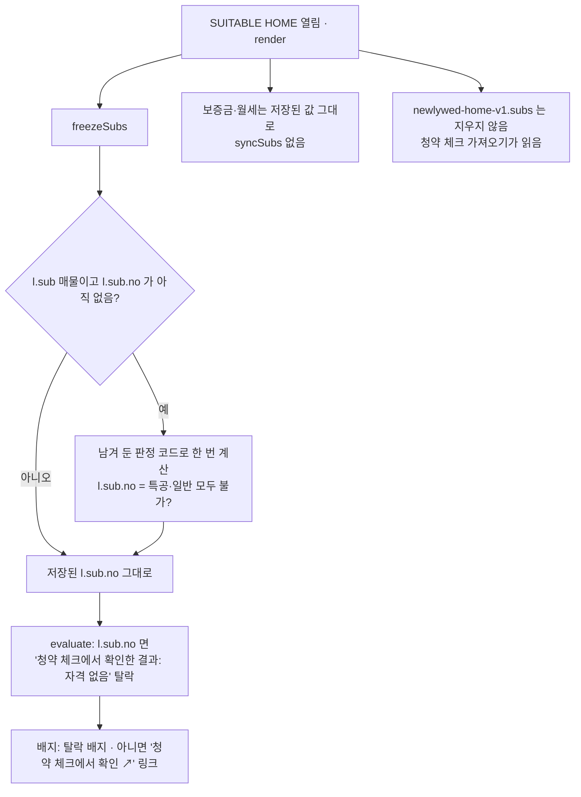

# 청약 빼기 — 청약은 청약 체크로 (v28, 2026-11-09)

청약 화면·판정 입력은 새 사이트 **청약 체크**(https://dionelee.github.io/cheongyak-check/)로 옮겼다.
SUITABLE HOME 에는 메뉴 자리의 링크와, 예전에 청약에서 넣은 매물(l.sub)의 마지막 판정만 남는다. 백업: `index_v28_backup.html`.

## 정한 것 (2026-11-09 사용자)

- 메뉴(위·휴대폰 탭바)의 '청약' 자리 → "청약 체크 ↗" 새 탭. 공모전 심사(~2027-01-20) 동안 유지
- 예전 주소 `#subs` → 홈
- 홈의 청약 일정 띠(`#subsNext`) 삭제 · 매물 청약 배지는 마지막 판정 또는 청약 체크 링크
- `newlywed-home-v1` 안의 `subs` 는 그대로 (내보내기에도 들어감)
- 청약 매물은 마지막 판정 그대로: 처음 한 번 `l.sub.no` 로 저장, 그 뒤로 다시 계산하지 않음. 보증금·월세도 마지막 값 그대로
- 판정 함수(`subMe`~`subInfo`)는 이 한 번의 계산·selfTest 용으로 **2027-01-20 까지** 남김 (그 뒤 `l.sub.no` 만 남기고 지워도 됨)
- `AI_SPEC` 블록(공고 PDF 지시문 포함)은 남김: `worker/src/spec.js` 와 같아야 하고(`scripts/sync_ai_spec.py`), 청약 체크가 같은 Worker 의 `/notice` 를 쓴다
- 청약 화면 CSS(`.sub-*` `.subs-*` `.wiz*` `#sub*` 만 있는 줄) 삭제

## 2단계 다음 (순서 지킬 것)

1. 작업 스케줄러 `suitable-home-feed-push` 끄기 (사용자 확인 후)
2. jev-harness `src/watch-housing.js` 의 `writeFeed`·`--feed` 빼기 (감시·판정·디스코드는 그대로)
3. `feed/notices.json` · `samples/feed_example.json` 지우기 (1·2 전에 지우면 다음 날 08:30 에 다시 만들어 올라감)

## 검사

`python -m http.server 8766 --bind localhost` 후 `v10_check.py`(청약 매물·메뉴·대출 계산기 20) · `ai_check.py`(매물 글 AI·실패 처리 22) · `v8_check.py` 56 · `v27_check.py` 29
