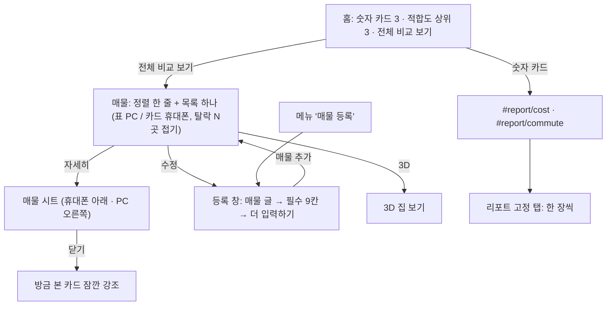

# v25 화면 길이 정리

화면 배치만 바꾼다. 계산·판정·AI 읽기(보내는 내용)·저장 구조는 그대로.

## 이번에 하는 것
1. AI 읽기: 끝나거나 실패·취소하면 "읽는 중" 문구 지우기 (매물 글·공고 PDF)
2. 매물 글: 버튼은 "AI로 읽기" 하나, 보내기 안내는 처음부터 버튼 위에 (공고 PDF는 파일을 고른 뒤 안내 → "AI로 읽기")
3. "AI가 N칸을 채웠어요" 한 줄 + 채운 칸은 테두리 색 (사람이 고치면 해제)
4. 등록 칸 이름 짧게 · 단위는 입력칸 안 오른쪽 · "모르면 비워 두기"는 흐린 예시 글
5. 매물 화면 목록은 한눈에 비교 하나만 (카드·표마다 자세히·수정·삭제·3D) — "매물 타입" 칸과 등록 아래 목록 없앰
6. 자세히 보기 = 매물 시트 (휴대폰 아래 · PC 오른쪽 패널). 닫으면 방금 본 카드가 잠깐 강조. 2D/3D·‹ ›·3D 크게 보기·가구 배치 그대로
7. 매물 등록 창 (휴대폰 아래 · PC 오른쪽): 매물 글 붙여넣기 → 필수 9칸(이름·지역·거래 유형·보증금·월세·관리비·면적·방 개수·통근) → "더 입력하기". 수정 때 제목 "매물 수정 · 이름"
8. 한눈에 비교 카드: 휴대폰은 3줄로 접혀 시작 · 탈락은 "탈락 N곳 보기"로 접기 · 정렬은 한 줄 가로 밀기
9. 홈: 숫자 카드 3 + 적합도 상위 3곳 + "전체 비교 보기" (한눈에 비교·더 깊이 보기·더 자세히 보기 없앰)
10. 리포트: 위쪽 고정 탭 비용·공간·통근·적합도·입지, 한 장씩. 주소 `#report/cost|space|commute|fit|location`
11. 계산식·판정 기준 각주 접기
12. 긴 화면 오른쪽 아래 "맨 위로"
13. 여백 토큰 `--s4` 36 / `--s5` 56 (휴대폰 28 / 40) · `.h2` 26~40px · 히어로 `clamp(460px, 68svh, 680px)` · 표 고정 열 경계선
14. 데이터 옮기기 · AI 설정 한 줄로 접기 ("AI 설정" 링크는 펼쳐서 이동)
15. 청약 판정 위에 신혼부부/청년 탭 · 돈 계산 접기
16. 우리 기준: 전부 탈락일 때 안내 문구

다음 차례: 3D 집 보기 2단 배치.

## 흐름

## 길이 (문서 높이 ÷ 창 높이, `scripts/verify/length_check.py`)

| 화면 | 데이터 | PC 1280 전 → 후 | 휴대폰 390 전 → 후 |
|---|---|---|---|
| 홈 | 예시 3곳 | 4.3 → 1.8 | 5.8 → 1.9 |
| 홈 | 가상 11곳 | 4.7 → 2 | 11 → 2 |
| 매물 | 예시 3곳 | 5.5 → 1.9 | 8.2 → 1.6 |
| 매물 | 가상 11곳 | 8 → 2.3 | 16.7 → 2.6 |
| 비교 리포트 | 예시 3곳 | 4.6 → 1.6 (가장 긴 탭) | 6.1 → 1.9 (가장 긴 탭) |
| 비교 리포트 | 가상 11곳 | 7.3 → 2.1 (가장 긴 탭) | 9.9 → 2.6 (가장 긴 탭) |
| 우리 기준 | 예시 3곳 | 1.9 → 1.7 | 3.2 → 2.9 |
| 우리 기준 | 가상 11곳 | 2.3 → 2.2 | 3.6 → 3.4 |
| 3D 집 보기 | 예시 3곳 | 2.3 → 2.2 | 2.8 → 2.6 |
| 3D 집 보기 | 가상 11곳 | 2.3 → 2.2 | 2.8 → 2.6 |
| 청약 | 예시 3곳 | 1.4 → 1.3 | 2.3 → 2.1 |
| 청약 | 가상 11곳 | 1.4 → 1.3 | 2.3 → 2.1 |

리포트 "후"는 다섯 탭 중 가장 긴 탭. 3D 집 보기는 이번에 바꾸지 않음(다음 차례 2단 배치).
